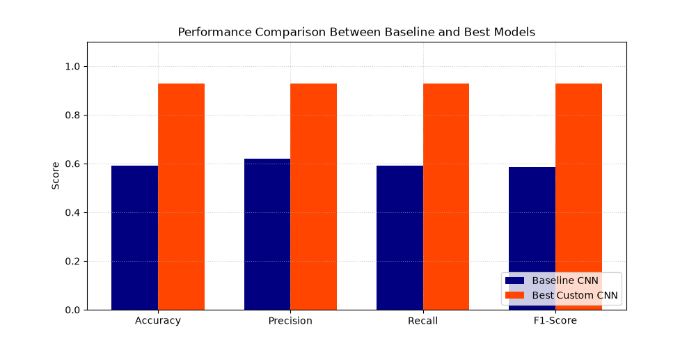

# ☀️ Infrared Solar Modules Anomaly Detection & Classification Pipeline

[](https://www.python.org/)
[](https://www.tensorflow.org/)
[](https://mlflow.org/)
[](https://onnxruntime.ai/)

This document provides a comprehensive overview of an end-to-end computer vision and deep learning pipeline designed to detect, classify, and analyze thermal anomalies in photovoltaic (PV) solar cells and modules using infrared thermography. The system benchmarks custom deep convolutional architectures against standard Transfer Learning approaches, providing full experiment tracking via **MLflow**, production-ready model exports (**Keras, H5, ONNX**), and Explainable AI (Grad-CAM) diagnostics.

---

## 📌 Table of Contents
1. [Project Overview & Architecture](#1-project-overview--architecture)
2. [Data Preprocessing & Class Imbalance Handling](#2-data-preprocessing--class-imbalance-handling)
3. [ETL Pipeline & Data Preparation](#3-etl-pipeline--data-preparation)
4. [Deep Learning Models & Architectures](#4-deep-learning-models--architectures)
5. [Training Strategy & Callbacks](#5-training-strategy--callbacks)
6. [Comprehensive Results & Performance Metrics](#6-comprehensive-results--performance-metrics)
7. [Explainable AI (Grad-CAM) & Model Export](#7-explainable-ai-grad-cam--model-export)
8. [Setup, MLflow Logging & ONNX Inference](#8-setup-mlflow-logging--onnx-inference)

---

## 1. Project Overview & Architecture
Solar PV maintenance heavily relies on accurately identifying thermal anomalies to prevent permanent cell degradation and catastrophic field failure. This project utilizes a balanced dataset of **120,000 thermal crop images** distributed evenly across **12 distinct anomaly classes**, built entirely using TensorFlow/Keras for model training, evaluation, and cross-platform production deployments (`.keras`, `.h5`, `.onnx`).

---

## 2. Data Preprocessing & Class Imbalance Handling
- **Data Source:** Solar module thermal crop dataset driven by the metadata registry (`module_metadata.json`).
- **Imbalance Handling:** Resolved severe original class disparity using **`RandomOverSampler`** from `imblearn`, scaling the dataset up to a fully balanced **120,000 images** (10,000 images per class).
- **Supported Classes:**
  * `Cell`, `Cell-Multi`, `Cracking`, `Diode`, `Diode-Multi`, `Hot-Spot`, `Hot-Spot-Multi`, `No-Anomaly`, `Offline-Module`, `Shadowing`, `Soiling`, `Vegetation`.

---

## 3. ETL Pipeline & Data Preparation
- **Dataset Splitting:**
  * **80% Training:** `96,000` images (`1,500` batches at batch size 64).
  * **20% Temp Split:** Divided equally into **10% Validation** (`12,000` images / `187` batches) and **10% Test** (`12,032` images / `188` batches).
- **Resolution & Normalization:** Scaled pixel intensity values to the range `[0, 1]` with native input dimensions of `(40, 24, 3)` (dynamically resized via an input layer to `(128, 128, 3)` when training VGG19).
- **Data Augmentation:** Applied random horizontal and vertical flips alongside minor rotations (`factor=0.05`) strictly to training partitions to preserve rotational invariance without synthetic distortion.
- **Pipeline Optimization:** Configured `tf.data.AUTOTUNE` prefetching to ensure asynchronous parallel execution across CPU preparation and GPU tensor execution.

---

## 4. Deep Learning Models & Architectures
Three distinct paradigms were developed and benchmarked:

1. **Baseline CNN (`Baseline_CNN`):**
   * A shallow 3-block convolutional network interleaved with `MaxPooling2D` layers, feeding into a flattened dense bottleneck to establish baseline performance metrics.
2. **Custom Enhanced CNN (`Solar_Thermal_CNN` - Best Model):**
   * A deeper multi-stage architecture integrating **Batch Normalization** across every convolutional block, progressive filter scaling (32 $\rightarrow$ 64 $\rightarrow$ 128 $\rightarrow$ 256), **Dropout (0.3 - 0.4)** for regularization, and a **Global Average Pooling 2D** head to retain spatial feature maps for downstream explainability.
3. **Transfer Learning (`VGG19`):**
   * A pretrained VGG19 backbone leveraging ImageNet weights with a frozen feature extraction base, augmented with input resizing (`224x224`), `GlobalAveragePooling2D`, and custom classification dense heads.

---

## 5. Training Strategy & Callbacks
All architectures were optimized using the **Adam** optimizer and `categorical_crossentropy` loss, governed by adaptive callbacks:
- **`EarlyStopping`:** Monitors validation loss (`val_loss`, patience = 4–5 epochs) with automatic restoration of optimal checkpoint weights.
- **`ReduceLROnPlateau`:** Dynamically drops the learning rate (factor = 0.2, minimum learning rate = `1e-6`) when validation plateaus.
- **`ModelCheckpoint`:** Persists intermediate peak models based on minimum validation loss.

---

## 6. Comprehensive Results & Performance Metrics

### 🏆 Benchmark Comparison Across All Models

| Model Architecture | Input Dimensions | Test Accuracy | Precision (Weighted) | Recall (Weighted) | F1-Score (Weighted) | Key Observations |
| :--- | :---: | :---: | :---: | :---: | :---: | :--- |
| **Baseline CNN** | $40 \times 24 \times 3$ | 59.18% | 0.6210 | 0.5920 | 0.5870 | Prone to overfitting; limited spatial context |
| **VGG19 (Transfer Learning)** | $224 \times 224 \times 3$ | 49.01% | 0.5030 | 0.4900 | 0.4850 | ImageNet feature mismatch; upscaling artifacts |
| **Custom Enhanced CNN** 🏆 | $40 \times 24 \times 3$ | **92.90%** | **0.9289** | **0.9290** | **0.9283** | **Optimal architecture for native thermal gradients** |



---

#### Key Diagnostic Insights:
- **Structural & Circuit Faults:** VGG19 exhibits reliable discriminative capability on macroscopic circuit defects, securing high precision on **Diode-Multi** (75.6%) and **Cracking** (71.6%), alongside solid F1-scores for **Diode-Multi** (0.675) and **Diode** (0.617).
- **Thermal Anomalies:** Detection of **Hot-Spot** and **Hot-Spot-Multi** achieved high recall rates (69.8% and 62.2%), demonstrating sensitive hotspot identification despite moderate false positive rates.
- **Fine-Grained Patterns:** Micro-level defects like **Cell** and **Cell-Multi** demonstrated degraded F1-scores (0.324 and 0.246), confirming that artificial interpolation upscaling introduces blur that obscures subtle intra-cell gradient variations.

---

## 7. Explainable AI (Grad-CAM) & Model Export
- **Grad-CAM Integration:** Hooked into the final convolutional layer (`last_conv_layer`) of the Custom Enhanced CNN to calculate activation gradients, generating thermal localization heatmaps that highlight the specific panel regions triggering the anomaly diagnosis.
- **Multi-Format Serialization:** Models and artifacts are serialized across three deployment standards:
  * Native Keras Archive (`.keras`)
  * Legacy Hierarchical Data Format (`.h5`)
  * Open Neural Network Exchange (`.onnx` via `tf2onnx` at `opset=15`) for high-throughput edge deployment.

---

## 8. Setup, MLflow Logging & ONNX Inference

### Environment Installation
```bash
git clone [https://github.com/RanaElmaghraby/Solar-Panel-Anomaly-Detection.git](https://github.com/RanaElmaghraby/Solar-Panel-Anomaly-Detection.git)
cd Solar-Panel-Anomaly-Detection

# Create virtual environment
python -m venv venv
.\venv\Scripts\activate   # Windows

# Install requirements
pip install tensorflow mlflow onnx onnxruntime tf2onnx matplotlib seaborn scikit-learn
